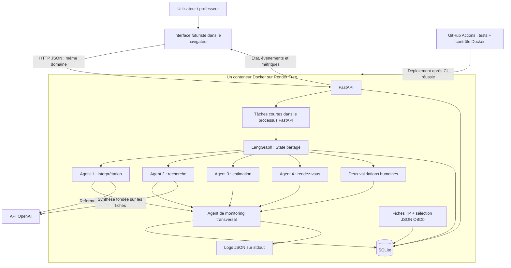
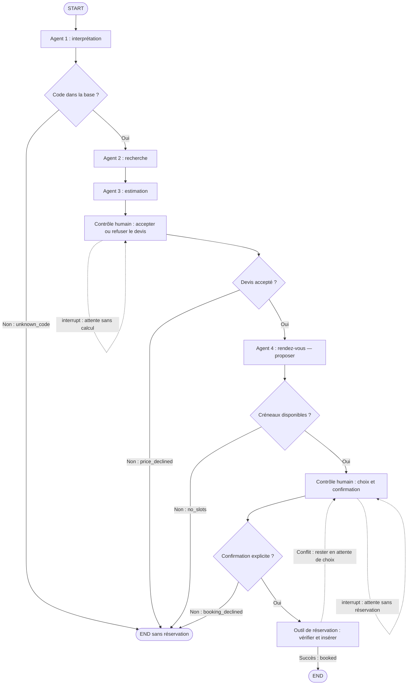
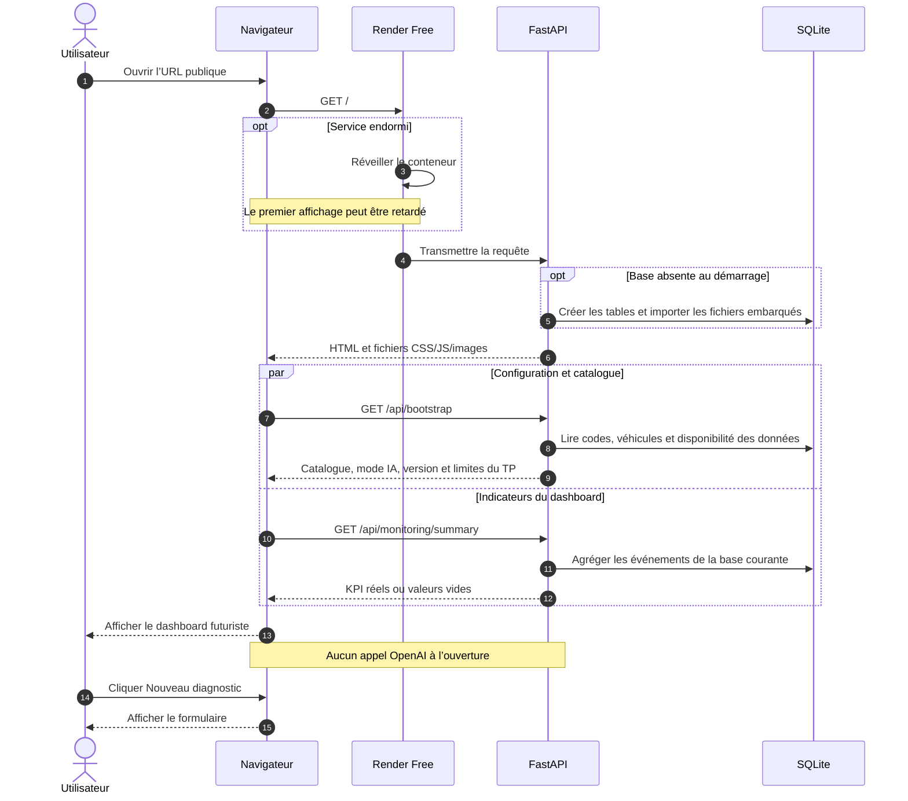
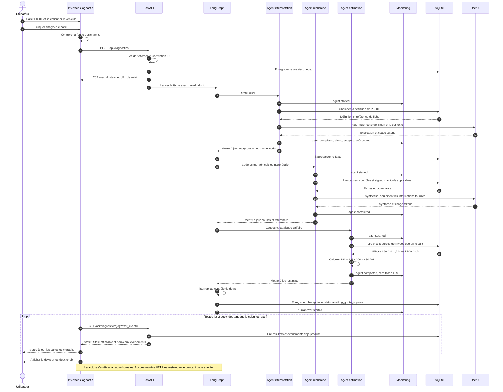
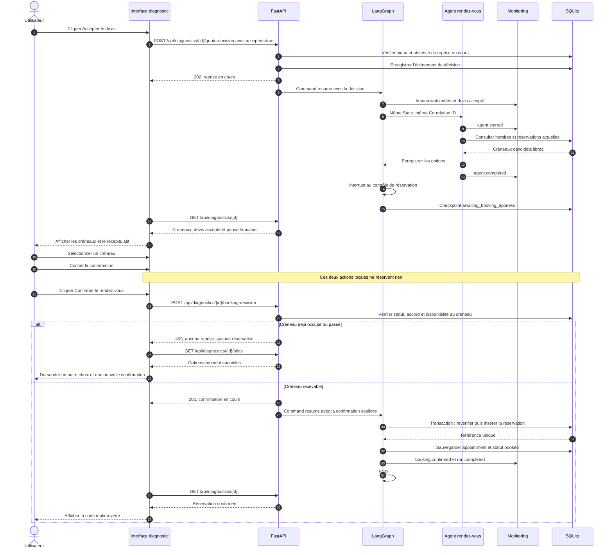
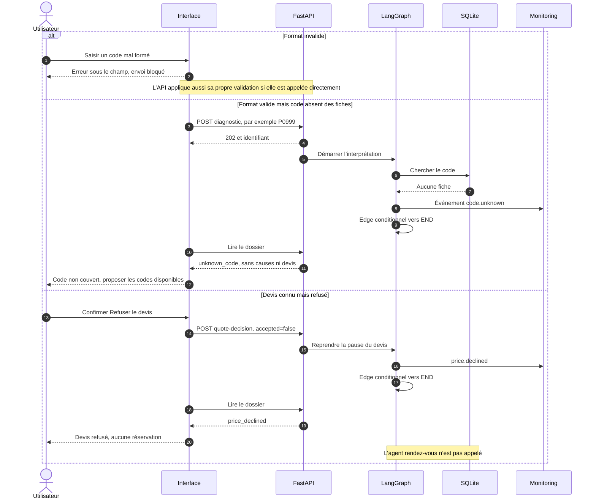
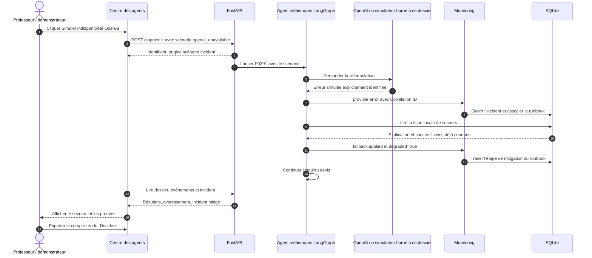
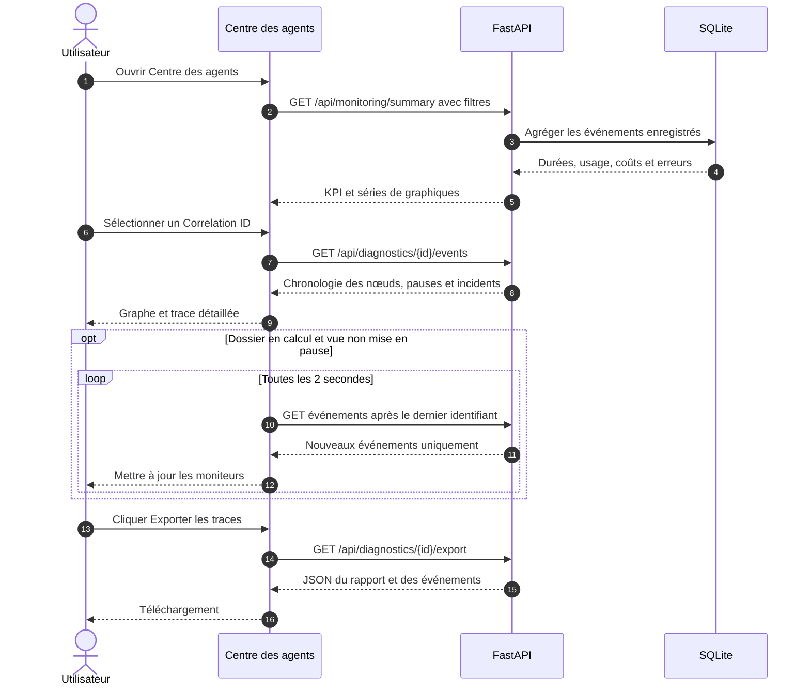
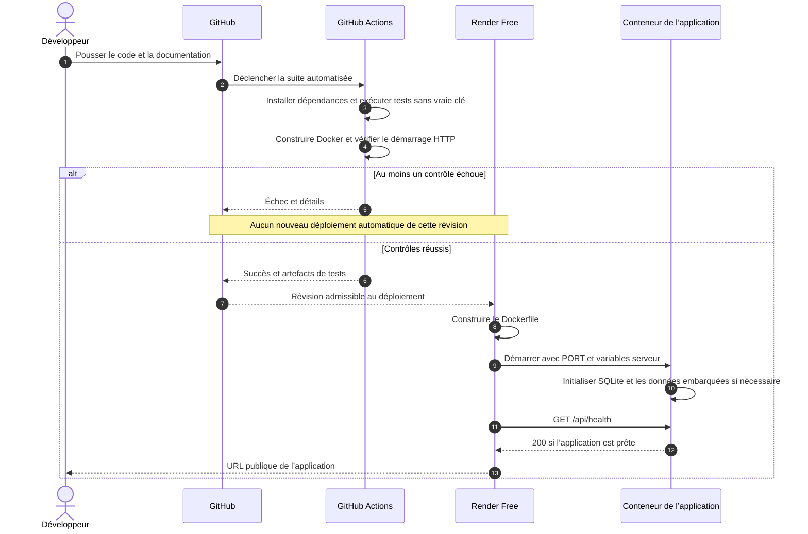

# AutoDiag AI — architecture et parcours complets

Document de conception du 30 octobre 2026, conservé comme référence du parcours validé. La mise en œuvre 2.0 est décrite dans le README et son état vérifié dans docs/VALIDATION.md ; ce document seul ne constitue pas une preuve de livraison cloud.

### Ajustements de mise en œuvre confirmés

- Le fournisseur est désormais **OpenRouter avec le modèle OpenAI openai/gpt-4o-mini**, selon le choix de l’utilisateur. La clé OpenRouter reste côté serveur.
- Les reprises humaines sans appel LLM sont rapides et synchrones : les endpoints de décision renvoient **200** avec le nouvel état, plutôt qu’un accusé 202. L’analyse initiale conserve une réponse 202 et un suivi par lectures courtes.
- Pour limiter le nombre de tables, les causes sont incluses dans les fiches kb_codes et les signaux dans les entrées vehicles, sous forme de JSON. Les références et filtres d’année restent conservés. Le monitoring est intégré à l’Engine, sans service supplémentaire.
- Le runbook est nommé **RB-LLM-01**, couvrant OpenRouter/OpenAI. Les incidents simulés ne consomment aucun token ; une erreur réelle sans usage renvoyé est signalée comme coût incomplet.
- Les documents, tests et sources sont des livrables locaux ; la CI distante et l’URL Render ne sont déclarées validées qu’après vérification effective.

## 1. Objectif et décisions de base

L’utilisateur saisit un code OBD-II et éventuellement un véhicule. L’application explique le code, recherche des causes dans une base technique, calcule une estimation en DH, attend l’acceptation du devis, propose des créneaux puis attend la confirmation avant d’enregistrer une réservation fictive. Un agent de monitoring observe ce parcours et alimente une interface de supervision.

Le professeur doit pouvoir constater : architecture multi-agents, Correlation ID, tests GitHub Actions réussis, Agent Cards, Docker, API cloud accessible, incident traité avec runbook, documentation et vidéo.

| Sujet | Décision proposée |
| --- | --- |
| Application | Un seul projet Python, un seul serveur FastAPI, un seul processus. |
| Orchestration | Un StateGraph LangGraph avec quatre agents métier et deux étapes de validation humaine. |
| Agent supplémentaire | Monitoring transversal à règles simples, exécuté dans le même processus. |
| Fournisseur IA | OpenAI pour l’interprétation et la synthèse des causes ; calcul et réservation par fonctions déterministes. |
| Stockage | SQLite local au conteneur, initialisé à partir de fichiers inclus dans le projet. |
| Interface | HTML, CSS, JavaScript, SVG et Chart.js ; aucune compilation frontend indispensable. |
| Cloud | Un Web Service Render Free construit à partir du Dockerfile. |
| Progression | Une requête de lancement, puis de courtes lectures périodiques du statut. Pas de service de messages supplémentaire. |
| Validation humaine | Deux pauses réelles du graphe, avec interrupt() et reprise du même thread. |
| Authenticité | Les mesures des agents viennent des exécutions ; les signaux automobiles animés sont simulés et identifiés. |
| Usage du TP | Données et réservations de démonstration ; aucun nom, téléphone, paiement ou contact atelier réel. |
| Persistance cloud | Aucune garantie après redémarrage/endormissement de Render Free ; export des preuves et rapports. |

Décision confirmée par l’utilisateur : les agents métier déterministes sont acceptés pour le calcul et la réservation. OpenAI est réservé aux tâches de langage. Les Agent Cards décrivent explicitement cette distinction.

## 2. Architecture générale



Les agents sont des rôles et des nœuds du graphe, pas cinq services à héberger. Les tâches FastAPI restent dans le même serveur ; elles ne constituent pas une file de travail durable. Un arrêt du serveur peut interrompre une analyse.

## 3. Organisation de l’interface

### 3.1 Direction visuelle obligatoire

- Référence principale : la seconde image fournie, sombre, avec des néons cyan, bleu, violet, vert et orange.
- Barre latérale fixe sur ordinateur ; navigation compacte sur mobile.
- Bannière automobile, voiture illustrée ou holographique, circuits et cadres lumineux.
- Nombreuses cartes, courbes, jauges, chronologies et petits moniteurs.
- Couleur stable par agent : interprétation bleu, recherche violet, estimation vert, rendez-vous orange ; monitoring cyan.
- Animation du nœud réellement actif, flux entre les étapes, confirmation visuelle des réussites et alertes d’incident.
- Les animations de présentation peuvent être décoratives ; les statuts métier ne sont jamais inventés pour animer l’écran.
- Sur petit écran, les panneaux s’empilent et les tableaux défilent à l’intérieur de leur carte.

### 3.2 Navigation : six pages, une application

Il n’y a pas de page de connexion. Dans ce TP, l’espace contient uniquement des données fictives et les listes présentent les dossiers de l’atelier de démonstration. Ce choix ne constitue pas un système de comptes clients.

Les routes côté navigateur utilisent un fragment (#/...) : le serveur sert toujours la même page et une actualisation reste simple à gérer.

| Menu | Route interface | Question à laquelle la page répond |
| --- | --- | --- |
| Tableau de bord | #/dashboard | Que fait l’application et où en est l’atelier ? |
| Diagnostic IA | #/diagnostic ou #/diagnostic/{id} | Quelle panne est suspectée et quelle action puis-je valider ? |
| Centre des agents | #/agents | Quels agents travaillent, avec quelles performances et quels coûts ? |
| Historique | #/history | Quels diagnostics ont été exécutés et comment retrouver un rapport ? |
| Rendez-vous | #/appointments | Quels créneaux ont réellement été confirmés dans le TP ? |
| Projet et validation | #/project | Où sont les Agent Cards, le runbook et les preuves demandées ? |

Éléments communs : logo, navigation active, statut API, mode IA ou secours, date locale, bouton thème/animations, mention « Prototype pédagogique », accès à l’aide. Une clé API ne se saisit pas dans l’interface publique : elle est configurée côté serveur.

### 3.3 Page 1 — Tableau de bord

Composition :

1. Bannière automobile avec « Du code OBD-II au rendez-vous » et bouton « Nouveau diagnostic ».
2. Cartes : diagnostics exécutés, erreurs techniques, coût API estimé, durée moyenne hors attente humaine.
3. Aperçu des quatre agents et de l’agent de monitoring.
4. Courbe d’activité récente et répartition des codes analysés.
5. Moniteurs automobiles de présentation : régime, température, tension, etc., seulement si ces signaux sont documentés pour le véhicule choisi.
6. Derniers diagnostics et prochains rendez-vous.
7. Mention visible : « Télémétrie simulée — aucune connexion à un véhicule ».

| Action | Effet exact |
| --- | --- |
| Nouveau diagnostic | Ouvre le formulaire vide ; aucun appel OpenAI. |
| Essayer P0301 | Préremplit le formulaire avec P0301 ; l’utilisateur doit encore cliquer sur Analyser. |
| Voir les agents | Ouvre la supervision avec les métriques des vraies exécutions. |
| Cliquer une analyse récente | Ouvre son dossier via son identifiant ; aucun recalcul. |
| Voir les rendez-vous | Ouvre les réservations confirmées. |
| Choisir un véhicule de présentation | Change les jauges documentées ; ne modifie pas un diagnostic existant. |

En l’absence de données, les métriques réelles affichent 0 ou « — ». Les jauges décoratives peuvent continuer à fonctionner dans leur zone de simulation.

### 3.4 Page 2 — Diagnostic IA : formulaire

| Champ | Règle |
| --- | --- |
| Code OBD-II | Obligatoire, un seul code, espaces extérieurs supprimés et lettres normalisées en majuscules. |
| Marque/modèle | Facultatif ; sélection dans un petit catalogue de véhicules. « Non précisé » est accepté. |
| Année | Facultative ; les signaux documentés sont filtrés selon les années couvertes. |
| Exemple | Puces P0301, P0420, P0171 ; elles remplissent le champ sans lancer l’analyse. |

La forme générale acceptée est une lettre P/B/C/U, un chiffre 0 à 3, puis trois caractères hexadécimaux. Une forme valide n’implique pas que le code existe dans notre base. La couverture exacte du TP est annoncée dans l’interface.

Boutons :

- « Analyser le code » : vérifie les champs, crée une exécution, puis ouvre son dossier.
- « Réinitialiser » : vide les champs avant envoi ; ne supprime aucune analyse existante.
- « Codes disponibles » : ouvre un panneau de recherche dans les fiches importées ; sélectionner une fiche remplit le code.
- « Aide » : explique comment retrouver le code d’un lecteur OBD externe. L’application ne scanne pas la voiture.

Pendant l’envoi, Analyser est désactivé pour éviter un double clic. Une erreur de saisie s’affiche sous le champ et ne déclenche aucun appel LLM.

### 3.5 Page 2 — Dossier de diagnostic

La page reste la même pendant toute la vie du dossier. Son contenu évolue selon le statut retourné par le serveur.

| Zone | Contenu |
| --- | --- |
| En-tête | Code, véhicule, année, statut, Correlation ID copiable et date. |
| Graphe central | Quatre agents et deux points de validation humaine ; étape active réellement animée. |
| Carte interprétation | Définition, explication simple, système concerné et origine de la réponse. |
| Carte recherche | Causes probables, contrôles suggérés, références de fiches et informations véhicule disponibles. |
| Carte estimation | Hypothèse de réparation, lignes de pièces, nombre d’heures, tarif horaire et total DH. |
| Carte rendez-vous | Créneaux uniquement après acceptation du devis ; confirmation ensuite. |
| Résumé latéral | Résultats disponibles, décision attendue et action principale. |
| Moniteurs secondaires | Durée des étapes, tokens, coût API de ce dossier ; signaux véhicule simulés séparés. |

#### État « Analyse en cours »

- Les résultats apparaissent à mesure que les nœuds se terminent.
- Un agent en cours porte le statut « En cours » ; les suivants « En attente ».
- L’utilisateur peut consulter les autres pages ; cela n’annule pas l’exécution.
- Aucun bouton de devis ou de réservation n’est actif avant la pause correspondante.
- Une navigation ou un rafraîchissement ne relance pas le graphe : on relit le dossier.

#### État « Devis à valider »

- Les trois premiers agents ont terminé ; LangGraph est suspendu.
- Affichage complet de l’hypothèse, des pièces, de la main-d’œuvre et du total.
- Boutons « Accepter le devis » et « Refuser le devis ».
- « Accepter » envoie une décision au serveur et reprend le même graphe ; l’agent rendez-vous peut alors proposer des créneaux.
- « Refuser » ouvre une petite confirmation « Refuser cette estimation ? ». Le bouton final « Confirmer le refus » termine le dossier sans rendez-vous ; « Revenir au devis » ferme cette boîte sans mutation.
- Aucun coût LLM supplémentaire pendant l’attente humaine.
- Le devis est un montant fictif du TP, pas une facture ni une promesse de réparation.

#### État « Créneau à confirmer »

- Carte atelier avec ville Casablanca, jours et heures locales.
- Créneaux sous forme de boutons radio ; aucun n’est sélectionné par défaut.
- Résumé : code, véhicule, montant accepté, date/heure sélectionnée.
- Case obligatoire « Je confirme la réservation de démonstration à cette date et à cette heure ».
- Bouton « Confirmer le rendez-vous », activable seulement avec un créneau et la case cochée.
- Bouton « Ne pas réserver » : après confirmation, termine le dossier sans réservation, tout en conservant l’acceptation du devis.
- Sélectionner un créneau ou cocher la case n’écrit encore aucune réservation.
- Un simple abandon de la page laisse le dossier en attente : il ne vaut ni accord ni refus.

#### État « Réservé »

- Confirmation verte, référence de réservation, atelier, créneau et montant indicatif.
- Boutons « Ajouter au calendrier », « Exporter le rapport », « Voir les rendez-vous », « Nouveau diagnostic ».
- Les anciens boutons de confirmation sont retirés.
- Le TP ne transmet pas d’email, ne contacte pas un garage réel et ne débite rien.
- Modifier ou annuler une réservation confirmée n’est pas prévu dans la version minimale ; seul le refus avant confirmation est couvert.

#### États de sortie sans réservation

- Code inconnu : explication de la couverture limitée, bouton « Codes disponibles », bouton « Modifier la saisie » ; aucun prix inventé.
- Devis refusé : rapport consultable et bouton « Nouvelle analyse » ; aucun créneau réservé.
- Réservation refusée : même comportement ; le devis accepté reste dans le rapport.
- Aucun créneau : message clair ; aucune réservation et aucun créneau fictif présenté comme libre.
- Erreur technique fatale : message lisible, Correlation ID et bouton « Relancer une nouvelle analyse » ; le nouveau lancement crée un nouvel identifiant.

Les champs d’un dossier envoyé sont immuables. « Nouvelle analyse » peut préremplir un nouveau formulaire, sans écraser ni rejouer le dossier initial.

### 3.6 Page 3 — Centre des agents

Objectif : visualiser le travail des agents et fournir les preuves d’observabilité.

Organisation dense :

1. Bandeau de KPI : exécutions, réussites techniques, erreurs, exécutions dégradées, durée moyenne, tokens, coût estimé.
2. Cinq cartes d’agents : rôle, état, exécutions, latence, erreurs et coût LLM attribué.
3. Graphe du dossier sélectionné ; l’utilisateur choisit un dossier existant dans une liste.
4. Courbe des durées de traitement au fil des exécutions.
5. Barres de durée moyenne par agent.
6. Tokens d’entrée et de sortie par agent.
7. Répartition du coût API ; les agents déterministes ont zéro coût LLM.
8. Journal déroulant : horodatage, agent, événement, durée, statut, Correlation ID.
9. Panneau incidents : détection, cause, action de secours, état et lien runbook.

| Contrôle | Effet exact |
| --- | --- |
| Filtre agent | Filtre les statistiques et événements, sans relancer un agent. |
| Filtre code/statut/période | Limite les dossiers inclus dans les agrégats. |
| Rechercher un Correlation ID | Ouvre la trace complète de ce diagnostic. |
| Cliquer un nœud | Ouvre un panneau : entrées utiles, sortie, durée, tokens, coût, erreur et références. |
| Pause visuelle | Stoppe l’actualisation de cette vue ; l’analyse serveur continue. |
| Reprendre | Relit les événements disponibles et reprend l’actualisation. |
| Exporter les traces | Télécharge les événements et métriques de la sélection en JSON. |
| Consulter Agent Card | Ouvre la fiche du rôle sélectionné. |
| Simuler indisponibilité OpenAI | Crée un diagnostic de test P0301 marqué « incident simulé » ; aucune panne globale n’est provoquée. |
| Données de présentation | Bascule les graphiques sur un jeu fictif étiqueté ; aucun appel OpenAI ni modification des statistiques réelles. |

Les vues « Exécutions de l’application », « Scénarios d’incident » et « Présentation fictive » sont identifiables. Par défaut, les KPI montrent les exécutions de l’application. Aucune mesure de précision du diagnostic n’est affichée sans jeu d’évaluation et vérité de référence.

### 3.7 Page 4 — Historique

Une ligne par exécution : date, code, véhicule, état, mode IA/secours, durée de traitement, coût API estimé et identifiant.

- Recherche par code, véhicule ou Correlation ID.
- Filtre de statut et de période ; pagination simple si nécessaire.
- « Ouvrir » : relit le dossier, jamais de nouvel appel LLM.
- « Reprendre » : ouvre uniquement les dossiers en attente de validation ; l’utilisateur doit toujours prendre la décision dans le dossier.
- « Exporter » : télécharge le rapport JSON.
- « Nouvelle analyse à partir de celle-ci » : préremplit un nouveau formulaire ; pas d’envoi automatique.
- État vide avec bouton « Lancer un diagnostic ».

L’historique de cette version est celui de l’atelier TP, sans gestion multi-comptes. Les anciennes données peuvent disparaître après un redémarrage cloud : cette limite est affichée.

### 3.8 Page 5 — Rendez-vous

- Vue liste des réservations réellement confirmées dans la base courante.
- Chaque carte : référence, code, véhicule, atelier, jour, heure locale et total indicatif.
- Filtre à venir/passés.
- « Voir le diagnostic » : ouvre le dossier associé.
- « Ajouter au calendrier » : télécharge un fichier .ics ; ne sollicite pas Google Calendar ou Outlook.
- « Exporter » : télécharge les détails de cette réservation.
- État vide : aucune réservation ; bouton « Commencer un diagnostic ».

Un dossier en attente de choix de créneau n’apparaît pas comme une réservation. Il reste accessible dans Historique.

### 3.9 Page 6 — Projet et validation

Cette page rend le projet facile à évaluer, sans créer une console d’administration supplémentaire.

Onglets :

1. **Architecture** : schéma général, graphe et explication du State.
2. **Agent Cards** : cinq fiches, versions et date de mise à jour.
3. **Tests et déploiement** : version/commit réellement déployé, lien de l’exécution GitHub Actions, lien du dépôt et état actuel /health.
4. **Runbook** : procédure d’indisponibilité OpenAI et scénario reproductible.
5. **Livrables** : documentation téléchargeable, scénario vidéo et lien vidéo une fois produit.

Pas de badge « Tests réussis » prérempli si aucun résultat CI correspondant n’a été vérifié. Un document ou une vidéo non encore produit porte « À fournir ».

## 4. Les cinq agents et leurs contrats

| Agent | Entrées | Travail et outils | Sorties | Appel OpenAI |
| --- | --- | --- | --- | --- |
| Interprétation | Code, véhicule/année facultatifs, fiche du code | Cherche d’abord une définition dans SQLite ; reformule sans inventer de couverture constructeur. | Code reconnu, titre, définition, explication, système, origine et avertissements. | Un appel si la fiche existe et la clé est configurée. |
| Recherche | Code reconnu, contexte véhicule | Lit causes et contrôles dans SQLite ; ajoute les métadonnées OBDb applicables ; produit une synthèse limitée aux fiches. | Causes avec références, contrôles, signaux documentés, synthèse et provenance. | Un appel facultatif pour la synthèse ; repli sur les fiches si échec. |
| Estimation | Causes et catalogue tarifaire fictif | Calcule l’hypothèse principale, pièces + heures × tarif horaire ; aucune estimation monétaire libre du LLM. | Devis détaillé, total DH, hypothèse et limites. | Aucun. |
| Rendez-vous | Devis accepté et disponibilités | Consulte les créneaux de l’atelier fictif ; prépare les options. Son outil de réservation est appelé seulement après la seconde validation humaine. | Créneaux, puis réservation confirmée ou absence de réservation. | Aucun. |
| Monitoring | Événements des nœuds et validations | Mesure, journalise, agrège, détecte les erreurs et suit les actions de secours avec des règles Python. | Traces, métriques, incidents et lien runbook. | Aucun. |

Le monitoring est un rôle technique transversal. Il ne s’exécute pas comme une cinquième étape après le rendez-vous : il observe chaque étape. Son Agent Card décrit ses événements d’entrée et ses décisions de détection/suivi d’incident.

Une seule tentative par appel OpenAI pour le TP ; délai d’attente configurable et court, sans boucle de réessais invisible. Le nombre maximal attendu est deux appels pour un diagnostic connu. La reprise d’une validation humaine ne répète aucun des deux appels.

## 5. State partagé et états métier

### 5.1 Contenu du State

| Champ | Usage |
| --- | --- |
| correlation_id | Identifiant du diagnostic ; également thread_id LangGraph. |
| code | Code normalisé, immuable après lancement. |
| vehicle | Marque/modèle/année ou valeur non précisée. |
| known_code | Résultat de la recherche de définition dans nos fiches. |
| interpretation | Définition, explication et système concerné. |
| causes | Causes et contrôles sélectionnés avec leurs références SQLite. |
| vehicle_signals | Signaux OBDb documentés et applicables ; pas de mesures réelles. |
| estimate | Hypothèse, pièces, heures, tarif, total et devise DH. |
| price_decision | pending / accepted / declined. |
| slot_candidates | Créneaux proposés pour ce parcours et identité de l’atelier. |
| booking_decision | pending / confirmed / declined ; créneau choisi à la confirmation. |
| appointment | Référence et créneau uniquement après insertion réussie. |
| status | État métier exposé à l’UI. |
| warnings | Repli OpenAI, manque de contexte véhicule et autres limites. |
| error | Erreur lisible et référence technique si l’exécution échoue. |

Les événements et les agrégats de monitoring sont stockés à part pour ne pas gonfler le State. Les tokens et coûts d’un dossier sont calculés à partir de ces événements.

### 5.2 Statuts exposés à l’interface

| Statut API | Libellé UI | Actions possibles |
| --- | --- | --- |
| queued | Analyse en préparation | Consulter ou quitter la page. |
| running | Analyse en cours | Consulter la progression ; aucune réservation possible. |
| awaiting_quote_approval | Devis à valider | Accepter ou refuser le devis. |
| awaiting_booking_approval | Créneau à confirmer | Choisir, confirmer ou ne pas réserver. |
| booked | Rendez-vous confirmé | Consulter et exporter. |
| price_declined | Devis refusé | Consulter, exporter, nouvelle analyse. |
| booking_declined | Réservation non souhaitée | Consulter, exporter, nouvelle analyse. |
| unknown_code | Code absent de la base | Consulter la couverture ou créer une autre analyse. |
| no_slots | Aucun créneau disponible | Consulter le rapport, créer une nouvelle analyse plus tard. |
| failed | Erreur technique | Consulter l’identifiant et lancer une nouvelle analyse. |

Un repli sur les fiches n’est pas un faux échec du parcours : il ajoute un indicateur degraded=true et une explication. Une analyse peut donc être booked et degraded à la fois.

### 5.3 Graphe cible



Les quatre agents correspondent à quatre nœuds métier. Les validations sont des nœuds techniques ; l’outil de réservation n’est pas un nouvel agent. Le schéma sépare cet outil pour montrer le moment exact de l’écriture. L’implémentation peut l’appeler dans le contrôle de confirmation, après interrupt().

Pour limiter la complexité, un conflit de disponibilité est normalement détecté par l’API AVANT la reprise du graphe : réponse 409, options actualisées et graphe toujours suspendu. La transaction d’écriture vérifie une seconde fois pour traiter une éventuelle concurrence.

## 6. Séquence 1 — ouverture de l’application



Le bootstrap ne renvoie jamais la clé OpenAI. Le badge « OpenAI configuré » signifie uniquement qu’une clé existe ; seul un appel réussi permet d’indiquer « OpenAI utilisé » sur un résultat.

## 7. Séquence 2 — analyse jusqu’à l’acceptation du devis



Les lectures périodiques peuvent avoir lieu en parallèle des calculs ; le dessin les regroupe pour rester lisible. Elles reprennent uniquement pendant une nouvelle phase de calcul. Les événements sont dédupliqués par leur identifiant.

## 8. Séquence 3 — devis accepté, créneau et réservation



Une contrainte unique protège chaque créneau d’atelier ; une autre protège la réservation d’un même dossier. Si la réponse réseau se perd, relire le dossier suffit. Une répétition de confirmation du même dossier et même créneau renvoie la réservation existante, sans seconde insertion. Une décision contradictoire sur un dossier terminé renvoie 409.

L’enregistrement de réservation et la mise à jour du checkpoint ne forment pas une unique transaction distribuée. L’outil doit donc retrouver une réservation déjà créée pour ce dossier lorsqu’il est rejoué après une interruption technique.

## 9. Séquence 4 — code inconnu et prix refusé



Un code non couvert est un résultat métier attendu, pas une panne OpenAI. Le refus d’un prix n’est pas compté comme une erreur technique.

## 10. Séquence 5 — incident OpenAI et runbook



Le scénario n’efface pas la clé, ne coupe pas le service et n’affecte pas les autres utilisateurs. Une panne réelle du fournisseur déclenche le même chemin de secours, avec une origine « réelle ».

Runbook RB-OPENAI-01 :

1. Détecter l’erreur et noter catégorie, heure, agent et Correlation ID.
2. Vérifier la présence d’une fiche locale permettant un repli.
3. Utiliser la fiche au lieu d’inventer un résultat.
4. Afficher « Mode secours : OpenAI indisponible ».
5. Vérifier que l’estimation et la pause humaine restent fonctionnelles.
6. Exporter traces, action appliquée et résultat de la vérification.
7. Si l’incident est réel, vérifier la configuration fournisseur et faire un essai ultérieur. Ne marquer « résolu » qu’après une vérification réussie ; un repli seul signifie « mitigé ».

Les erreurs SQLite ou une impossibilité d’écrire une réservation ne sont pas masquées par une confirmation verte : le dossier reste non confirmé ou échoue clairement.

## 11. Séquence 6 — consultation de la supervision



Sans analyse en cours, une actualisation manuelle ou une fréquence plus lente suffit. Une page masquée ne continue pas à interroger le serveur toutes les deux secondes. Aucun appel OpenAI n’est effectué pour consulter un graphe.

## 12. Séquence 7 — GitHub Actions et Render



Le réglage Render visé est « After CI Checks Pass ». Le job obligatoire de tests ne doit pas être ignoré. Le service écoute sur 0.0.0.0 et le port fourni par Render ; aucune URL locale codée en dur dans les appels frontend.

## 13. Contrat des requêtes API

### 13.1 Principes

- L’interface et l’API ont la même origine ; aucune seconde application frontend à déployer.
- Chaque diagnostic reçoit un UUID non devinable utilisé comme identifiant de dossier et Correlation ID.
- Les requêtes liées à un dossier conservent cet identifiant ; les logs le reprennent.
- Les erreurs HTTP portent un message lisible et, si un dossier existe, son Correlation ID.
- POST lance/reprend le calcul ; GET lit uniquement. Un rafraîchissement ne déclenche jamais de nouvel appel OpenAI ni de réservation.
- Après une réponse 202, l’interface attend le statut réel ; elle n’annonce pas une réussite sur le seul accusé de réception.
- Un verrou court par dossier évite deux reprises simultanées. Il n’est pas maintenu pendant l’attente humaine.

### 13.2 Liste des endpoints

| Méthode et route | Entrée | Réponse / usage |
| --- | --- | --- |
| GET / | Aucune | Interface unique et navigation par fragments. |
| GET /api/health | Aucune | 200 si serveur et SQLite sont accessibles ; version du service. Pas d’appel OpenAI. |
| GET /api/bootstrap | Aucune | Codes, véhicules, signaux applicables, mode configuré, version et limites. |
| POST /api/diagnostics | code, véhicule facultatif, année ; scénario de démo facultatif borné | 202 : id, status=queued, URL de suivi. 422 si saisie invalide. |
| GET /api/diagnostics | Filtres facultatifs | Liste de l’historique courant. |
| GET /api/diagnostics/{id} | after_event facultatif | State affichable, action humaine attendue et nouveaux événements. |
| POST /api/diagnostics/{id}/quote-decision | accepted: true/false | 202 si reprise, 409 si action incompatible ; même dossier, pas de nouvel identifiant. |
| GET /api/diagnostics/{id}/slots | Aucune | Options encore éligibles et libres pour ce dossier, horaires Casablanca. |
| POST /api/diagnostics/{id}/booking-decision | confirmed: true/false ; slot_id si true | 202 si reprise ; 409 si créneau occupé ou état incompatible ; 422 si données incomplètes. |
| GET /api/diagnostics/{id}/events | after_event, agent facultatifs | Événements de monitoring ordonnés et paginés. |
| GET /api/diagnostics/{id}/export | Aucune | Rapport, décisions, métriques et traces JSON. |
| GET /api/monitoring/summary | Période, agent, statut, origine | KPI et séries calculés sur les mêmes filtres. |
| GET /api/monitoring/incidents | Filtres facultatifs | Incidents, mitigation, résolution vérifiée et runbook. |
| GET /api/appointments | À venir/passés | Réservations confirmées uniquement. |
| GET /api/appointments/{id}/calendar | Aucune | Fichier ICS à télécharger. |
| GET /api/project | Aucune | Agent Cards, documents, version et liens de preuves. |

Une demande de confirmation d’un créneau est réévaluée côté serveur ; le montant et les causes ne peuvent pas être modifiés par un champ caché du navigateur. Les API ne prétendent pas offrir une gestion d’identité : elles concernent uniquement les données fictives du TP public.

### 13.3 Exemple de lancement et de réponse

Entrée POST /api/diagnostics :

```json
{
  "code": "P0301",
  "vehicle_id": "toyota-corolla-hybrid",
  "year": 2020
}
```

Réponse illustrative, identifiant généré à chaque lancement :

```json
{
  "id": "<correlation-id-genere-par-le-serveur>",
  "status": "queued",
  "status_url": "/api/diagnostics/<correlation-id-genere-par-le-serveur>"
}
```

Le navigateur ne génère pas de coûts, ne décide pas qu’un agent a terminé et ne fabrique pas une référence de réservation.

## 14. Stockage et intégration OBDb

### 14.1 Deux sources complémentaires

**Base diagnostic du TP :** définitions de codes, causes, contrôles, prix fictifs et temps d’intervention. Première couverture proposée : P0301, P0300, P0302, P0420, P0171, P0101, P0115, P0128, P0442, P0455. La liste ne sera affichée comme disponible qu’après création et vérification des fiches correspondantes.

**OBDb :** documentation de signaux par véhicule et année. Première sélection proposée : Toyota Corolla Hybrid et Honda Civic, en filtrant les signaux réellement applicables aux années choisies. Une définition de signal n’est ni une mesure actuelle ni une preuve d’une panne.

Les fichiers OBDb examinés ne remplacent pas la base de causes et de tarifs en DH. Les signaux servent à la fiche véhicule et aux moniteurs de présentation. Ils ne modifient pas le diagnostic comme s’il s’agissait de mesures réelles.

### 14.2 Import simple et reproductible

1. Sélectionner quelques fichiers JSON OBDb et conserver leurs versions/commits exacts.
2. Inclure ces fichiers, les crédits et les informations de licence dans le dépôt du TP.
3. À l’initialisation, importer catalogue et signaux utiles dans SQLite.
4. Conserver l’URL source et la version sur les données importées.
5. Filtrer les variantes par année ; exclure les signaux de débogage ou non pris en charge dans la sélection minimale.
6. Ne jamais interroger GitHub à chaque diagnostic.

Si aucun signal n’est documenté pour le modèle/année, afficher « Pas de données OBDb sélectionnées pour cette version », sans emprunter les signaux d’un autre modèle en les présentant comme compatibles.

### 14.3 Tables logiques

| Table | Contenu |
| --- | --- |
| kb_codes | Code, définition et système. |
| kb_causes | Causes par code, contrôles, rang d’hypothèse, pièces et durées fictives. |
| vehicles | Modèle, années de couverture et provenance. |
| vehicle_signals | Identifiant de signal, nom, unité, règles et années applicables. |
| diagnostics | Index des dossiers, statut, timestamps et résultats utiles à l’historique. |
| events | Événements de monitoring avec Correlation ID. |
| appointments | Dossier, atelier et créneau, avec contraintes d’unicité. |
| incidents | Erreur, origine, runbook, mitigation et résultat de vérification. |
| Tables du checkpointer LangGraph | État nécessaire aux pauses et reprises ; géré par le checkpointer SQLite. |

Il s’agit d’un seul stockage embarqué, sans serveur de base à installer. Un checkpointer SQLite remplace la mémoire seule du premier prototype. Des lectures de monitoring ne modifient pas les checkpoints.

### 14.4 Disponibilités de l’atelier

- Un atelier fictif à Casablanca.
- Une ressource de réservation pour le TP : un créneau ne peut être attribué qu’une fois.
- Horaires proposés : lundi à vendredi, débuts à 09:00, 11:00 et 14:00, sur les prochains jours ouvrés.
- Un créneau représente un accueil pour diagnostic/prise en charge, pas la garantie que toute réparation sera achevée dans une durée fixe.
- Pas de créneau passé. Les dates sont stockées sous une forme non ambiguë et affichées en Africa/Casablanca.
- Créneaux présents comme candidats dans le dossier, puis filtrés selon l’occupation actuelle.
- Si tous sont pris, le client peut renoncer à réserver ; aucun prix n’est débité.

### 14.5 Limites Render Free assumées

Le service gratuit s’endort après 15 minutes sans trafic. Le réveil prend environ une minute. Les fichiers locaux modifiés, y compris SQLite, sont perdus lors d’un redémarrage, redéploiement ou endormissement ; aucun disque persistant gratuit n’est disponible.

Conséquences décidées pour le TP :

- Recréation automatique des fiches et du catalogue depuis les fichiers embarqués.
- Les diagnostics, réservations, traces et checkpoints ne sont pas garantis après ces événements.
- Affichage « Données de démonstration temporaires » et export des preuves avant la soutenance.
- Un lien vers un ancien dossier absent retourne 404 et un écran « Session expirée ou dossier introuvable », avec bouton nouvelle analyse.
- Le navigateur ne présente pas son ancien cache comme une réservation encore confirmée sur le serveur.
- Si l’exigence devient une conservation durable, un stockage externe sera nécessaire ; ce n’est pas inclus dans l’architecture minimale actuelle.

## 15. Monitoring, performance et coûts

### 15.1 Événement minimal

Champs : event_id, correlation_id, agent, node, event_type, timestamp, duration_ms éventuelle, outcome, modèle éventuel, input_tokens, output_tokens, estimated_cost_usd, pricing_version, error_category éventuelle, incident_id éventuel et origin.

Les clés API ne sont jamais journalisées. Les événements stockent les résultats et références utiles, pas un raisonnement interne supposé du modèle.

Types utiles : run.started, agent.started, agent.completed, agent.failed, provider.error, fallback.applied, human.wait.started, human.wait.ended, quote.accepted, price.declined, booking.confirmed, booking.declined, run.completed, run.failed.

Les pauses LangGraph sont des événements attendus. L’exception technique qui met en œuvre interrupt() ne doit pas être capturée comme un incident fournisseur ou une erreur d’agent.

### 15.2 Règles des métriques

| Mesure | Définition |
| --- | --- |
| Durée agent | Temps réellement passé à exécuter le nœud métier, mesuré côté serveur. |
| Durée de traitement | Temps des phases de calcul ; exclut les deux attentes humaines. |
| Durée du parcours | Temps entre création et fin ; inclut l’attente du client, affiché séparément. |
| Latence moyenne | Moyenne sur les exécutions terminées de l’agent avec mesure disponible. |
| Taux d’erreur technique | Nombre d’exécutions échouées pour raison technique / nombre d’exécutions clôturées ; le dénominateur est affiché. |
| Parcours dégradés | Nombre de dossiers ayant utilisé au moins une fois le repli local. |
| Réussite de réservation | Nombre de réservations confirmées ; distinct de la réussite technique et de la précision médicale/mécanique. |
| Tokens | Usage renvoyé par OpenAI pour les appels réussis, attribué à leur agent. |
| Coût LLM estimé | Usage × tarifs configurés du modèle ; coût affiché en USD avec version/date des tarifs. |

Coût estimé = input_tokens × prix_entrée_par_million / 1 000 000 + output_tokens × prix_sortie_par_million / 1 000 000. Si le modèle distingue des tokens d’entrée en cache, leurs tarifs sont traités séparément ou l’approximation est annoncée.

Pas de conversion automatique en DH pour l’API dans la version minimale. Le devis automobile est en DH ; le coût technique de l’IA est un autre indicateur en USD. L’hébergement gratuit ne rend pas l’API OpenAI gratuite.

Pour une étape sans appel LLM : coût et tokens à zéro. Pour un appel tenté dont l’usage n’est pas disponible : « Indisponible » ; ne pas prétendre que son coût est forcément nul. Les totaux indiquent lorsqu’une partie de l’usage manque. Les tarifs non configurés conduisent à « Coût non calculé », pas à un prix inventé.

## 16. Gestion des erreurs et interactions limites

| Situation | Réaction serveur | Réaction interface |
| --- | --- | --- |
| Code mal formé | 422, aucun graphe lancé | Erreur sous le champ, saisie conservée. |
| Code valide absent | Statut unknown_code via edge conditionnel | Pas de causes/prix inventés ; proposer les codes disponibles. |
| Véhicule non renseigné | Analyse générique | Mention « Contexte véhicule non précisé ». |
| Modèle/année sans signal | Aucun signal constructeur ajouté | Carte indisponible explicite. |
| Clé absente | Mode fiches locales | Badge « Mode démo sans OpenAI », pas de faux incident fournisseur. |
| Erreur ou délai OpenAI | Repli fiche et incident tracé si possible | Avertissement visible, parcours dégradé. |
| Réponse LLM hors fiche ou invalide | Rejet de la synthèse, repli local | Aucun montant ou fait inventé intégré. |
| Catalogue incomplet, prix non disponible | Échec explicite d’estimation | Pas d’acceptation ni de réservation à partir d’un total nul fictif. |
| Refus du devis | price_declined, END | Rapport conservé, aucune réservation. |
| Client quitte une pause | Checkpoint conservé tant que la base existe | Reprise par Historique ou lien du dossier. |
| Double clic pendant lancement | Bouton verrouillé dans l’UI | Une seule analyse attendue ; une nouvelle demande explicite reste un nouveau dossier. |
| Deux reprises du même dossier | Contrôle du statut et verrou court | 409 ou état déjà enregistré ; pas de double calcul/réservation. |
| Créneau occupé | 409, aucune confirmation | Recharger les options, retirer le choix et demander une nouvelle confirmation. |
| Réponse perdue après réservation | Lecture du dossier ou requête identique idempotente | Montrer la réservation existante, pas un second créneau. |
| Erreur d’écriture réservation | Pas de confirmation de succès | Message avec Correlation ID ; contrôle du dossier avant réessai. |
| Plus de créneau | no_slots si découvert à la proposition ; renoncement possible si tous se remplissent après | Pas de faux créneau, bouton nouvelle analyse ou ne pas réserver. |
| Réseau navigateur perdu | Le serveur peut continuer | « Connexion interrompue », bouton « Réessayer la lecture », sans relancer le POST. |
| Rafraîchissement ou retour arrière | Lecture uniquement | Reconstituer l’écran à partir du statut serveur. |
| Redémarrage avec dossier récupérable | Checkpoint et index relus ; dossier de calcul interrompu marqué failed si aucune tâche n’est vivante | Message clair ; pas de spinner infini. |
| Base cloud effacée | Dossier introuvable, données initiales réimportées | Message session expirée ; nouvelle analyse nécessaire. |
| Aucun résultat de supervision | Agrégats vides | Zéros et tirets, ou bascule volontaire vers présentation fictive. |

## 17. Scénario de référence de A à Z

Ce scénario utilise des résultats et montants d’exemple, pas un diagnostic garanti pour une voiture réelle.

1. L’utilisateur ouvre l’URL Render. Après un éventuel réveil, le dashboard apparaît.
2. Il voit le thème sombre, la voiture illustrée, les KPI, les agents et les jauges portant « Télémétrie simulée ».
3. Il clique « Nouveau diagnostic ».
4. Dans Diagnostic IA, il clique l’exemple P0301 puis choisit Toyota Corolla Hybrid, année 2020. Il pourrait laisser le véhicule vide.
5. Il clique « Analyser le code » ; l’API renvoie un identifiant et le dossier s’affiche.
6. L’agent d’interprétation devient bleu actif. Il retrouve la définition et explique les ratés du cylindre 1. Le résultat précise qu’un contrôle est nécessaire.
7. L’agent de recherche devient violet actif. Il lit les fiches SQLite et présente, par exemple, bougie, bobine et injecteur, sans attribuer de fausses probabilités chiffrées.
8. L’agent d’estimation devient vert actif. Hypothèse fictive : bougie, 180 DH de pièces + 1,5 h à 200 DH/h = 480 DH.
9. Le graphe affiche « Devis à valider ». L’agent rendez-vous est encore en attente.
10. L’utilisateur peut exporter son rapport à ce stade ou ouvrir Centre des agents ; le dossier reste suspendu.
11. Il revient au dossier et clique « Accepter le devis ».
12. LangGraph reprend le même thread. L’agent rendez-vous consulte les créneaux libres.
13. La page affiche « Créneau à confirmer ». Pour un lancement le vendredi 30 octobre 2026, les jours ouvrés suivants peuvent commencer le lundi 2 novembre 2026, selon les disponibilités.
14. L’utilisateur sélectionne lundi à 11:00. Le récapitulatif change mais aucune réservation n’est encore écrite.
15. Il coche la confirmation puis clique « Confirmer le rendez-vous ».
16. Le serveur vérifie la place, reprend le graphe et enregistre la réservation une seule fois.
17. La confirmation verte montre référence, date, heure de Casablanca, atelier fictif et montant indicatif.
18. Il clique « Ajouter au calendrier » pour télécharger le .ics.
19. Il ouvre Rendez-vous : la réservation apparaît. Il clique « Voir le diagnostic » pour retrouver exactement le même dossier.
20. Il ouvre Historique et exporte le rapport JSON.
21. Il ouvre Centre des agents, sélectionne ce dossier et voit les durées, tokens disponibles, coûts estimés, événements et pauses avec le même Correlation ID.
22. Il consulte les Agent Cards, puis les preuves GitHub Actions et le runbook dans Projet et validation.
23. Pour la démonstration d’incident, il lance le scénario OpenAI indisponible : le monitoring montre la panne simulée, le repli et la mitigation.
24. Il exporte les preuves et peut filmer la démonstration complète.

Variante refus : à l’étape 11, « Refuser le devis » puis « Confirmer le refus » mène à price_declined. L’agent rendez-vous ne s’exécute pas.

Variante conflit : si le créneau devient occupé entre les étapes 14 et 16, la page retire le choix, présente les disponibilités restantes et exige une nouvelle confirmation.

## 18. Tests et preuves de validation

| Exigence | Vérification prévue | Preuve à livrer |
| --- | --- | --- |
| Architecture multi-agents | Contrats des quatre rôles métier et monitoring, ordre de passage et State | Graphe, code cible et cinq Agent Cards. |
| Correlation ID | Même identifiant dans State, événements et reprises humaines | Export d’une trace complète. |
| Code inconnu | Aucun passage recherche/estimation/rendez-vous pour un code absent | Test automatisé + capture UI. |
| Devis | Calcul exact sur des fixtures contrôlées | Test pièces + main-d’œuvre, exemple 480 DH. |
| Refus du devis | Aucun appel à l’agent rendez-vous, aucune réservation | Test de branche conditionnelle. |
| Validation humaine | Aucun enregistrement avant confirmation ; la sélection seule ne suffit pas | Tests du graphe et démonstration UI. |
| Concurrence/idempotence | Même créneau jamais attribué deux fois ; répétition ne crée pas de doublon | Tests de réservation et de conflit. |
| Monitoring | Durées et événements cohérents ; pauses non comptées comme erreurs | Tests et export JSON. |
| Coûts | Usage connu calculé ; usage absent signalé ; agents déterministes à zéro | Tests sans vraie clé OpenAI. |
| Incident/runbook | Panne simulée détectée, fiche de repli, statut dégradé et mitigation | Test + rapport d’incident RB-OPENAI-01. |
| OBDb | Import reproductible, source/version présentes et filtre année | Test de fixture JSON importée. |
| CI | Suite réellement exécutée, sans appel OpenAI facturé | Lien vers GitHub Actions réussi pour la révision livrée. |
| Docker/cloud | Image démarre et /api/health répond ; interface et API publiques | Dockerfile + URL Render + test HTTP. |
| Gouvernance | Cinq fiches renseignées et versions correspondant à la livraison | Documents Agent Cards. |
| Documentation/vidéo | Parcours nominal, refus et incident reproductibles | README, architecture, runbook et vidéo enregistrée. |

Un test vert ne valide pas à lui seul l’application du runbook ou le déploiement cloud. Chaque ligne nécessite sa propre preuve. Un scénario d’incident simulé est décrit comme tel dans la vidéo et les exports.

## 19. Structure cible du dépôt

```text
app/
  main.py                  API, démarrage et tâches locales
  graph.py                 State, nœuds, edges et contrôles humains
  agents/                  quatre rôles métier
  monitoring.py            événements, métriques et incidents
  storage.py               SQLite, imports et réservations
  data/
    diagnostics.json       fiches et tarifs fictifs
    obdb/                  petite sélection JSON versionnée + crédits
static/
  index.html               interface unique
  styles.css               thème futuriste et responsive
  app.js                   navigation, requêtes et progression
  assets/                  illustrations et bibliothèques incluses
tests/                     tests métier, API et monitoring
docs/
  ARCHITECTURE_ET_PARCOURS.md
  agent-cards/             cinq fiches
  runbooks/                RB-OPENAI-01 et compte rendu
  demo-video.md            scénario et lien de la vidéo produite
.github/workflows/ci.yml
Dockerfile
render.yaml                service Free et healthcheck
requirements.txt
README.md
.env.example
```

Ce plan de dossiers reste interne ; l’utilisateur final ne voit pas cette complexité dans son parcours. Le lancement local doit tenir en une commande Python après installation, sans fichier batch obligatoire.

## 20. Ordre de réalisation après validation de la conception

1. Construire une tranche complète avec données fictives : formulaire → quatre agents → deux validations → réservation.
2. Ajouter les branches code inconnu, refus et conflit.
3. Instrumenter les agents et afficher les vraies traces.
4. Importer la petite sélection OBDb et finaliser les moniteurs de présentation.
5. Appliquer le thème futuriste, les graphiques et le responsive aux six vues.
6. Compléter tests, Agent Cards et runbook ; vérifier l’incident.
7. Vérifier Docker, exécuter la CI puis déployer sur Render.
8. Vérifier le parcours public, exporter les preuves et enregistrer la vidéo.

Il ne s’agit pas de huit produits séparés : chaque étape complète la même application. Aucun nouveau développement n’est lancé par ce document.

## 21. Décisions confirmées par l’utilisateur

Réponses reçues dans l’ordre des trois questions : « oui, non, non ».

| Point | Réponse | Conséquence retenue |
| --- | --- | --- |
| Agents déterministes pour calcul et réservation acceptés ? | Oui | OpenAI pour les tâches de langage ; calcul du devis et réservation par fonctions Python contrôlées. |
| Conservation après redémarrage obligatoire ? | Non | SQLite temporaire sur Render Free, données initiales recréées au démarrage et exports disponibles. Aucun stockage externe nécessaire. |
| Modèle obligatoire d’Agent Card ou de runbook ? | Non | Fiches et procédure adaptées au TP, avec les éléments nécessaires aux critères de validation. |

Les cinq Agent Cards couvriront rôle, contrats d’entrées/sorties, outils, limites, erreurs, versions et tests associés. Le runbook décrira détection, mitigation, vérification et preuves de l’incident.

Ces trois incertitudes sont levées. Elles ne déclenchent pas la reprise du développement : ce document reste la base de revue du parcours et des diagrammes. La vidéo demeure un livrable obligatoire, avec un scénario à préparer.

## 22. Références vérifiées

- [LangGraph — interruptions, checkpoints et reprise](https://docs.langchain.com/oss/python/langgraph/interrupts)
- [FastAPI — tâches d’arrière-plan dans l’application](https://fastapi.tiangolo.com/tutorial/background-tasks/)
- [Render — limites du plan gratuit](https://render.com/docs/free)
- [Render — Docker](https://render.com/docs/docker)
- [Render — comportement de déploiement après CI](https://render.com/docs/deploys)
- [OpenAI — SDK Python et Responses API](https://developers.openai.com/api/reference/python)
- [OBDb — organisation et provenance](https://github.com/OBDb)
- [OBDb — exemple Corolla Hybrid](https://github.com/OBDb/Toyota-Corolla-Hybrid/blob/main/signalsets/v3/default.json)
- [OBDb — exemple Honda Civic](https://github.com/OBDb/Honda-Civic/blob/main/signalsets/v3/default.json)

Les contraintes externes sont vérifiées au moment de la conception ; elles devront être revérifiées si le plan ou les services changent avant la livraison.
