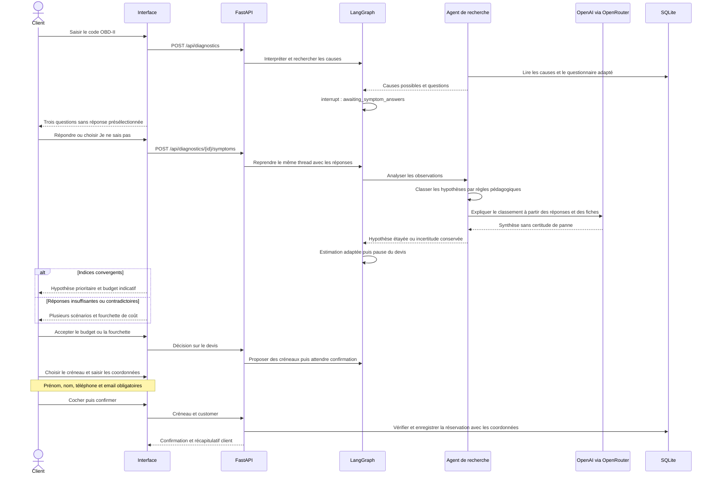

# Version 2.1 — observations du client et coordonnées de réservation

Le code OBD-II ne suffit plus à choisir une réparation. Un nouveau dossier suit ce parcours :

## Règles de diagnostic

- Trois questions adaptées à la famille du code : allumage, admission, échappement, refroidissement ou EVAP.
- Les questions portent sur des observations accessibles au client, pas sur un démontage ou un essai de réparation.
- Toutes les questions doivent recevoir une réponse ; « Je ne sais pas » est toujours disponible.
- Les réponses sont validées côté serveur et conservées dans le State/checkpoint LangGraph.
- Les règles de classement du TP figurent dans `app/symptoms.py`. Leurs points ne sont ni des pourcentages ni une validation scientifique des causes.
- Une cause unique n’est retenue comme hypothèse prioritaire que si plusieurs observations convergent suffisamment. Sinon, `selected_index=null` et aucun prix unique n’est attribué.
- OpenRouter reçoit les réponses, les fiches et le classement pour expliquer les indices et les limites. Le prix reste calculé par Python à partir du catalogue fictif.
- L’agent de recherche travaille en deux phases : collecte des causes/questions, puis analyse des réponses. Il reste un seul rôle métier, même si le monitoring mesure deux passages.

Exemples de fixtures P0301, sans valeur de diagnostic réel :

| Réponses | Hypothèse / résultat | Budget fictif |
| --- | --- | --- |
| À froid + bougies anciennes + aucun lien avec un plein | Bougie prioritaire | 480 DH |
| À l’accélération + bougies récentes + aucun lien avec un plein | Bobine prioritaire | 950 DH |
| Je ne sais pas aux trois questions | Aucune hypothèse unique | 480 à 1 250 DH selon les scénarios |

## Coordonnées

La confirmation exige `customer = {first_name, last_name, phone, email}`. Les noms sont non vides ; téléphone et email ont une validation de format. Une renonciation à réserver n’exige pas de coordonnées.

Les coordonnées sont enregistrées avec la réservation et visibles dans son dossier/récapitulatif. Elles ne sont ni envoyées au modèle ni incluses dans les événements de monitoring. Les listes globales exposent le nom du client mais pas son téléphone/email ; l’export du dossier comprend les coordonnées.

Le TP reste sans gestion de comptes et avec une base éphémère. Les exemples de test et les preuves de livraison utilisent des coordonnées fictives. Saisir un email ne déclenche aucun envoi automatique.

## Compatibilité

Les anciens dossiers restent consultables. Un ancien devis calculé sans questionnaire doit faire l’objet d’une nouvelle analyse avant une nouvelle acceptation. Les réservations historiques sans coordonnées restent affichables sans erreur.

Pour tester la nouvelle version : redémarrer le serveur puis lancer un **nouveau** diagnostic. Rafraîchir simplement un ancien dossier ne crée pas les réponses manquantes.
